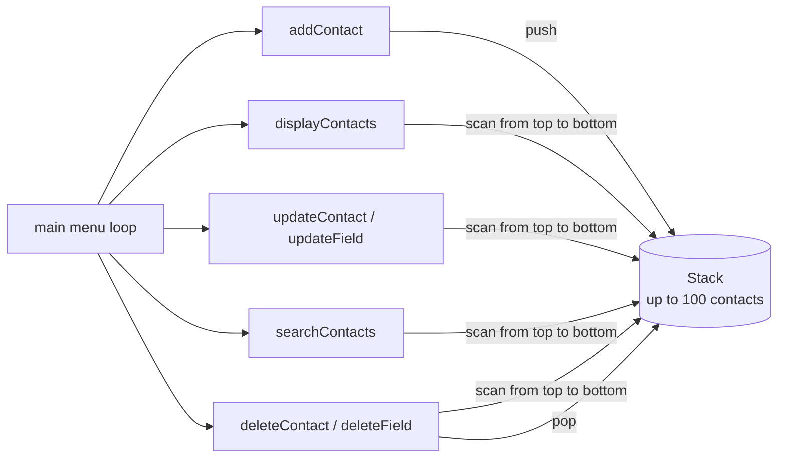

# Contact Management System

A command-line address book written in C. Contacts are kept in memory on a **stack** (an array of up to 100 contact pointers), and the program shows how push and pop can be used to add, find, edit and delete records.

## What it does

```
Address Book Menu:
1. Add Contact
2. Display Contacts
3. Update Contact
4. Search Contacts
5. Delete Contact
6. Delete Field
7. Exit
```

| Option | What happens |
|---|---|
| Add | Prompts for each field and pushes the new contact onto the stack |
| Display | Prints every contact |
| Update | Finds a contact by exact name and lets you change one field |
| Search | Finds contacts by exact name |
| Delete | Removes a contact by name |
| Delete field | Clears one field of a contact |

Each contact stores **name, phone, email, social media handles, home address, work address and company name**.

## How it works



New contacts are pushed on top. Display, search, update and delete-field walk the array from the newest contact to the oldest and compare names. Delete pops the top of the stack.

## Building and running

```bash
gcc -Wall -o contacts kit.c
./contacts
```

## Limits

- Contacts live in memory only and are lost when the program exits.
- Name lookups read a single word (`scanf("%s")`) and match it exactly, so a name with a space in it can't be found.
- **Bug:** Delete Contact removes the contact on top of the stack, not necessarily the one whose name matched. It's only correct when the match is the newest contact.
- The stack holds at most 100 contacts.

## Tech stack

C (standard library only)
